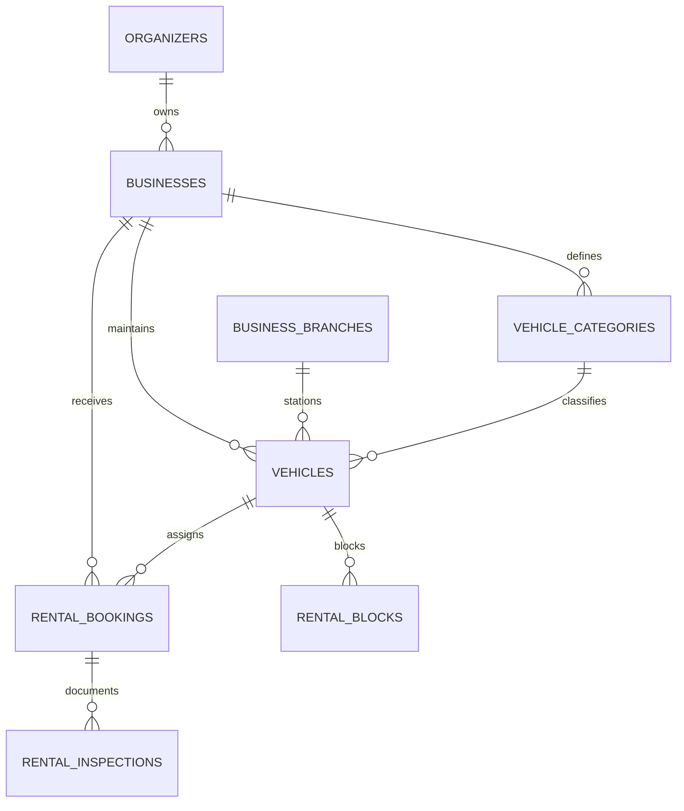
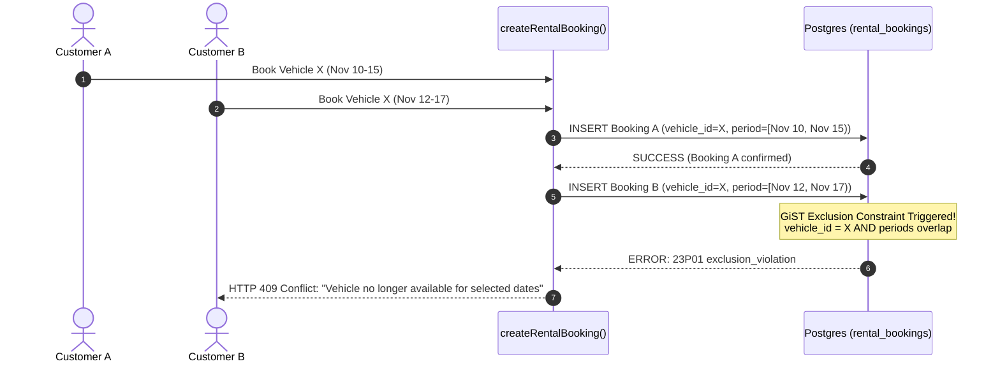
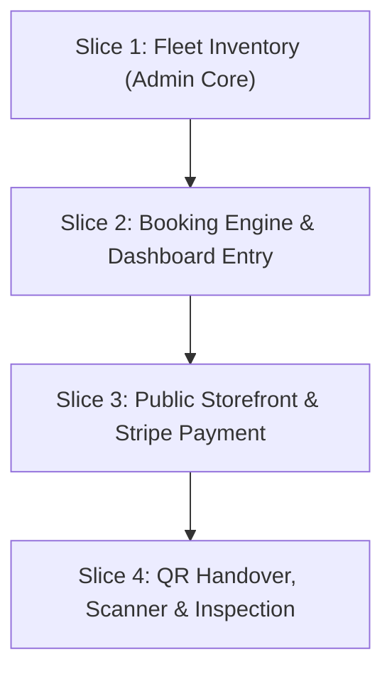

# Aldriva Architecture Decision Document: Vehicle Rental & Extensible Resource Engine

> **Document:** `docs/design/rental/architecture.md`  
> **Status:** Approved Architecture Blueprint  
> **Date:** 2026-11-08  
> **Author:** Pair Programming Agent  
> **Target Branch:** `feat/rental-overview`  
> **Context & Baseline:** Derived from verified findings in [`docs/investigation/rental-audit.md`](file:///c:/Users/Youngyz/aldriva-scanner-p0/docs/investigation/rental-audit.md)  

---

## 1. Overview & Architectural Principles

Aldriva's unified commerce platform serves multiple business verticals through a shared tenant model rooted in `organizers.id` (`DEC-0003`) and capability-composed interfaces (`lib/business-taxonomy.ts`). While food/beverage (`MENU`, `ORDERS`), retail (`PRODUCTS`), and appointment services (`SERVICES`, `APPOINTMENTS`) have mature operational models, **Vehicle Rental** (`VEHICLES`, `VEHICLE_RENTAL`) has operated in a deferred state with `routeExists: false` in the module registry.

This document defines the technical architecture for a first-class **Vehicle Rental Engine**. It is designed with modularity so other discrete rentable physical resources—such as accommodation units (`ROOMS`), private venues (`VENUE`), and high-value tools/equipment—can leverage the same underlying booking and availability infrastructure in future phases without architectural refactoring.

### Core Product Owner Directives (Enforced from Day One)
1. **Single Engine / Dual Ingress:** Bookings originate from two channels: owner/staff entry via the dashboard (office/phone) and customer bookings online. Both write to the identical `rental_bookings` record with a `source` enum (`'online' | 'office'`). Both **must** execute through a single shared server action enforcing pricing, duration constraints, and database-level overlap validation.
2. **Currency:** `USD` default. Currency is explicitly recorded as an immutable snapshot per vehicle and per booking to support multi-currency extensions without schema alterations.
3. **Deposits v1:** Recorded only (collected offline or waived). Deposits are **never** treated as rental revenue and must not pollute gross sales metrics. Online pre-authorizations are deferred post-Slice 3. Any deposit retention requires explicit `owner` or `manager` sign-off with a documented reason.
4. **Online Payments:** Rental charges reuse Aldriva's existing Stripe Checkout rail; office bookings are marked `paid`/`unpaid` manually by staff.
5. **Confirmation Mode:** Per-business setting for `instant` confirmation vs `approval` required (defaulting to `approval`).
6. **Allocation Mode:** Support manual staff assignment AND automatic allocation, built together in Slice 2. Per-business setting `allocation_mode` (`'manual' | 'auto_on_confirm' | 'auto_on_booking'`), defaulting to `'manual'`.
7. **Fuel Policy:** Default policy is **Full-to-Full** across the platform.

### Database Migration Sequence Verification
- A full historical audit of all branches (`git log --all`) confirmed that **zero active migrations numbered 224 or above exist** anywhere in the repository.
- An earlier branch commit created `db/migration_231_overview_rollups.sql`, but this was explicitly renumbered to `db/migration_223_overview_rollups.sql` in commit `31d20268d`.
- Therefore, the migration sequence for the rental engine begins consecutively at **`migration_224`** with zero collision risk.

---

## 2. Architecture Decisions

### Decision 1: Booking Assignment & Allocation Model
- **Decision:** The booking engine supports **both** specific unit booking and category-level booking, coupled with a hybrid allocation model built in Slice 2.
- **Storage Fields on `rental_bookings`:**
  - `category_id`: Mandatory UUID referencing `vehicle_categories`.
  - `vehicle_id`: Nullable UUID referencing `vehicles`.
  - `assigned_by`: Text nullable (`'auto'` or auth user ID).
  - `assigned_at`: Timestamptz nullable.
- **Allocation Settings:** Configured per business in `businesses.metadata->'rental_settings'->>'allocation_mode'`:
  - `'manual'` (Default): `vehicle_id` remains `NULL` until staff explicitly selects a physical vehicle from the dispatch dashboard.
  - `'auto_on_confirm'`: Category booking holds capacity; when staff approves/confirms the booking, the engine automatically assigns an available vehicle.
  - `'auto_on_booking'`: The engine assigns a vehicle immediately upon booking submission (under category advisory lock).
- **Auto-Allocation Algorithm:**
  - Runs inside the booking transaction under the category advisory lock (`pg_advisory_xact_lock`).
  - Filters candidates: `category_id = p_category_id AND is_active = true`.
  - Excludes vehicles with overlapping `rental_blocks` or active/pending `rental_bookings` for the requested window.
  - Ranking rule: Configurable priority (default: **lowest current mileage**, preferring vehicles stationed at the requested `pickup_branch_id`).
  - Concurrency retry: If the assigned candidate fails the GiST exclusion constraint due to a concurrent specific-unit booking, the transaction catches error `23P01` and retries allocation for the next eligible candidate before failing.
  - Staff override: Staff can manually reassign the vehicle at any time prior to physical customer handover.
- **Rationale:** High-volume operators need automation to eliminate manual dispatch overhead, whereas boutique or specialized fleets require manual curation. Building both options in Slice 2 satisfies both workflows.
- **Alternatives Rejected:**
  - *Unit-Only Selection:* Rejected because vehicle downtime or return delays force booking cancellations instead of simple reassignment within the same category.
  - *Category-Only Selection:* Rejected because staff cannot track vehicle handover, odometer readings, license plates, or physical asset utilization without unit-level assignment.

---

### Decision 2: Pricing Model for v1, Currency Snapshot & Billing Boundaries
- **Decision:** Pricing is defined at both the category and vehicle levels using base daily and weekly rates. The booking snapshot locks the financial agreement, and a per-business setting governs billing boundaries.
- **Pricing Schema Attributes:**
  - `daily_rate`: numeric(12,2) NOT NULL
  - `weekly_rate`: numeric(12,2) NULL (optional discounted weekly block)
  - `min_duration_days`: integer NOT NULL DEFAULT 1
  - `max_duration_days`: integer NOT NULL DEFAULT 30
  - `currency`: text NOT NULL DEFAULT 'USD'
  - `pricing_tiers`: jsonb NOT NULL DEFAULT '[]'::jsonb (reserved for future seasonal or duration-tiered rates)
- **Currency Snapshot Rule:** The booking stores an **immutable snapshot** of `currency` and `rental_amount` at creation time. If vehicle or category rates change subsequently, the stored booking values never mutate. All financial rollups, Stripe intents, and receipts for that booking strictly reference `rental_bookings.currency`.
- **Billing Boundary Setting:** Configured in `businesses.metadata->'rental_settings'->>'billing_boundary'`:
  - `'rolling_24h'` (Default for car rentals): 24-hour rolling windows from pickup timestamp. (e.g., Monday 10:00 to Tuesday 10:00 = 1 day; Monday 10:00 to Tuesday 13:00 = 2 days, subject to grace period).
  - `'calendar_day'`: Calendar days regardless of time. (e.g., Monday 09:00 to Monday 18:00 = 1 day; Monday 09:00 to Tuesday 09:00 = 2 calendar days).
- **Grace Period & Late Returns (v1):**
  - **Grace Period:** 60-minute return grace window after `ends_at` before late penalties apply.
  - **Late Return Flagging:** If the vehicle is returned past `ends_at + 60 minutes`, the system sets `is_overdue = true` and calculates `overdue_hours`.
  - **Manual Late Fee:** To prevent unannounced credit card disputes, v1 handles late fees via manual operator discretion:
    - Fields: `late_fee_amount` (numeric DEFAULT 0.00), `late_fee_status` (`'none' | 'pending' | 'collected' | 'waived'`), and `late_fee_notes`.
    - Staff reviews the delay during physical return inspection, calculates the fee, and either collects it at the counter or retains it from the security deposit with documented justification.
- **Rationale:** Car rentals universally operate on 24-hour clocks, while equipment and venue rentals operate on calendar days. Manual late fee settlement prevents chargeback fraud during early operational phases.

---

### Decision 3: Security Deposits (Financial Separation & Lifecycle)
- **Decision:** Security deposits are tracked as independent liability records and are **strictly segregated from rental revenue**.
- **Financial Rule:** Rental charges are recorded as sales revenue; deposits are tracked as a temporary custodial liability. Deposits must never appear in `salesToday`, order aggregates, or organizer revenue rollups.
- **Deposit Lifecycle States:**
  - `none`: No deposit required.
  - `pending_collection`: Required on pickup; not yet received.
  - `collected_offline`: Cash, external card terminal, or manual guarantee recorded by staff.
  - `returned_full`: Returned in full upon clean vehicle check-in.
  - `partially_retained`: Portion retained for fuel, cleaning, damages, or late return.
  - `retained_full`: Fully retained due to major breach/damage.
- **Storage Fields on `rental_bookings`:**
  - `deposit_required_amount`: numeric(12,2) NOT NULL DEFAULT 0.00
  - `deposit_collected_amount`: numeric(12,2) NOT NULL DEFAULT 0.00
  - `deposit_retained_amount`: numeric(12,2) NOT NULL DEFAULT 0.00
  - `deposit_status`: text NOT NULL DEFAULT 'none' CHECK (deposit_status IN ('none', 'pending_collection', 'collected_offline', 'returned_full', 'partially_retained', 'retained_full'))
  - `deposit_retention_reason`: text NULL
  - `deposit_retention_authorized_by`: uuid NULL REFERENCES auth.users(id)
  - `deposit_notes`: text NULL
- **Governance Rule:** Any deposit retention (`partially_retained` or `retained_full`) requires explicit **`owner` or `manager` role authorization** and a mandatory `deposit_retention_reason`.
- **Deferred:** Stripe credit card hold/pre-authorization (`capture_method: 'manual'`) is deferred to post-Slice 3.
- **Rationale:** Mixing deposits into gross sales causes incorrect tax reporting, incorrect platform revenue metrics, and reconciliation errors upon return. Offline recording satisfies immediate operational needs without Stripe Connect underwriting barriers.

---

### Decision 4: Database Tables by Slice (Tenant Scoping, RLS, Indexes)

All tables strictly enforce multi-tenant scoping via `organizer_id` and `business_id` referencing `organizers(id)` and `businesses(id)` with `ON DELETE CASCADE`.



#### Slice 1 Tables (Fleet Inventory)
1. **`vehicle_categories`**
   - **Columns:** `id` (uuid, PK), `organizer_id` (uuid, FK), `business_id` (uuid, FK), `name` (text, e.g. "Compact SUV"), `slug` (text), `description` (text), `daily_rate` (numeric), `weekly_rate` (numeric), `deposit_amount` (numeric), `currency` (text), `specs` (jsonb: `{ seats, transmission, doors, luggage, ac }`), `photo_url` (text), `sort_order` (int), `created_at`, `updated_at`.
   - **RLS:** Standard `is_entity_member(organizer_id)` for manage; public `SELECT` for active categories.
   - **Indexes:** `UNIQUE(business_id, slug)`, `idx_vehicle_categories_org(organizer_id)`.
2. **`vehicles`**
   - **Columns:** `id` (uuid, PK), `organizer_id` (uuid, FK), `business_id` (uuid, FK), `category_id` (uuid, FK), `branch_id` (uuid, FK nullable to `business_branches`), `make` (text), `model` (text), `year` (int), `license_plate` (text), `vin` (text nullable), `color` (text), `current_mileage` (int), `fuel_type` (text: 'gasoline', 'diesel', 'electric', 'hybrid'), `status` (text: 'available', 'rented', 'maintenance', 'out_of_service'), `is_active` (boolean DEFAULT true), `created_at`, `updated_at`.
   - **RLS:** Private to tenant staff (`is_entity_member(organizer_id)`). Public never queries individual vehicle records directly.
   - **Indexes:** `UNIQUE(business_id, license_plate)`, `idx_vehicles_category(category_id)`, `idx_vehicles_status(organizer_id, status)`.

#### Slice 2 Tables (Booking Engine & Availability)
3. **`rental_bookings`**
   - **Columns:**
     - Identifiers: `id` (uuid, PK), `lookup_token` (uuid DEFAULT gen_random_uuid()), `booking_number` (text, e.g. `RBK-261108-1001`), `organizer_id` (uuid, FK), `business_id` (uuid, FK), `category_id` (uuid, FK), `vehicle_id` (uuid, FK nullable)
     - Allocation: `assigned_by` (text nullable), `assigned_at` (timestamptz nullable)
     - Channels: `source` (text: 'online', 'office')
     - Timing: `starts_at` (timestamptz), `ends_at` (timestamptz), `expires_at` (timestamptz nullable), `booking_period` (tstzrange GENERATED ALWAYS AS (tstzrange(starts_at, ends_at, '[)')) STORED)
     - Locations: `pickup_branch_id` (uuid, FK to `business_branches`), `return_branch_id` (uuid, FK to `business_branches`)
     - Customer: `customer_name` (text), `customer_email` (text), `customer_phone` (text), `driver_license_number` (text nullable), `driver_license_country` (text nullable), `driver_dob` (date nullable)
     - Status: `status` (text: 'pending', 'confirmed', 'active', 'completed', 'cancelled', 'expired', 'no_show')
     - Financials: `rental_amount` (numeric), `deposit_required_amount` (numeric), `deposit_collected_amount` (numeric), `deposit_retained_amount` (numeric), `deposit_status` (text), `currency` (text), `payment_status` (text: 'unpaid', 'paid', 'refunded'), `late_fee_amount` (numeric DEFAULT 0), `late_fee_status` (text DEFAULT 'none')
     - Handover: `picked_up_at` (timestamptz nullable), `returned_at` (timestamptz nullable), `start_mileage` (int nullable), `end_mileage` (int nullable), `is_overdue` (boolean DEFAULT false)
     - Metadata: `notes` (text nullable), `created_at`, `updated_at`.
   - **RLS:** Tenant staff full access; anon/customer read strictly via token RPC exposing a scrubbed single-row projection.
   - **Indexes:** `idx_rental_bookings_vehicle_period` (GiST on vehicle_id, booking_period), `idx_rental_bookings_dates` (organizer_id, starts_at, ends_at), `idx_rental_bookings_status` (organizer_id, status), `UNIQUE(lookup_token)`.
4. **`rental_blocks` (Maintenance / Blackout Holds)**
   - **Columns:** `id` (uuid, PK), `organizer_id` (uuid, FK), `business_id` (uuid, FK), `vehicle_id` (uuid, FK), `starts_at` (timestamptz), `ends_at` (timestamptz), `block_period` (tstzrange GENERATED ALWAYS AS (tstzrange(starts_at, ends_at, '[)')) STORED), `reason` (text: 'maintenance', 'inspection', 'repair', 'owner_use'), `notes` (text), `created_at`.
   - **RLS:** Tenant staff only.
   - **Constraint:** Prevents vehicle allocation during maintenance windows.

#### Slice 4 Tables (Inspections & Condition Reports)
5. **`rental_inspections`**
   - **Columns:** `id` (uuid, PK), `organizer_id` (uuid, FK), `booking_id` (uuid, FK), `vehicle_id` (uuid, FK), `inspection_type` (text: 'pickup', 'return'), `fuel_level` (text: 'empty', 'quarter', 'half', 'three_quarters', 'full'), `odometer` (int), `condition_notes` (text), `photo_urls` (text[]), `inspector_id` (uuid, FK `auth.users`), `signed_by_customer` (boolean), `created_at`.
   - **RLS:** Tenant staff read/write; customer read-only view of their inspection record.

---

### Decision 5: Double-Booking Prevention & Capacity Logic

Concurrency safety cannot rely on application-level checks. Aldriva mandates database-level guarantees.



#### 1. Unit Bookings (Specific Vehicle Assigned)
- **Mechanism:** PostgreSQL `btree_gist` extension with an exclusion constraint (`EXCLUDE USING gist`):
```sql
ALTER TABLE public.rental_bookings
ADD CONSTRAINT uq_rental_bookings_no_overlap
EXCLUDE USING gist (
  vehicle_id WITH =,
  booking_period WITH &&
)
WHERE (status IN ('pending', 'confirmed', 'active'));
```
- A twin constraint is applied on `rental_blocks`.
- Any concurrent transaction attempting an overlapping insertion immediately raises `23P01 (exclusion_violation)` and aborts cleanly.

#### 2. Category Capacity Check (Period-Scoped, Not Current Status)
- **Correction to Audit Flaw:** The capacity check must evaluate vehicle availability **across the requested future period**, not whether a vehicle's current real-time status is `'available'`. (A car out on rental today is fully available next week).
- **Exact Capacity Formula:**
```sql
-- Count eligible vehicles in category that have NO overlapping maintenance blocks
WITH eligible_vehicles AS (
  SELECT v.id FROM public.vehicles v
  WHERE v.category_id = p_category_id 
    AND v.is_active = true
    AND v.status <> 'out_of_service'
    AND NOT EXISTS (
      SELECT 1 FROM public.rental_blocks b
      WHERE b.vehicle_id = v.id 
        AND b.block_period && p_requested_period
    )
),
-- Count assigned active/pending bookings in that window
assigned_conflicts AS (
  SELECT count(DISTINCT rb.vehicle_id) AS cnt
  FROM public.rental_bookings rb
  WHERE rb.vehicle_id IN (SELECT id FROM eligible_vehicles)
    AND rb.booking_period && p_requested_period
    AND rb.status IN ('pending', 'confirmed', 'active')
),
-- Count unassigned category bookings in that window
unassigned_conflicts AS (
  SELECT count(*) AS cnt
  FROM public.rental_bookings rb
  WHERE rb.category_id = p_category_id
    AND rb.vehicle_id IS NULL
    AND rb.booking_period && p_requested_period
    AND rb.status IN ('pending', 'confirmed', 'active')
)
SELECT 
  (SELECT count(*) FROM eligible_vehicles) - 
  (SELECT cnt FROM assigned_conflicts) - 
  (SELECT cnt FROM unassigned_conflicts) AS available_capacity;
```
- If `available_capacity <= 0`, the transaction aborts with `CATEGORY_CAPACITY_EXCEEDED`.

#### 3. Pending Holds & Expiry Rules
- **Hold Enforcement:** `pending` bookings actively consume category capacity and hold assigned vehicles (`status IN ('pending', 'confirmed', 'active')`).
- **Checkout Expiry:** When a customer initiates online checkout, a pending booking holds capacity for **35 minutes** (coordinated with Stripe's 30-minute minimum session expiration). If payment/submission is not completed, it is discarded.
- **Approval Expiry:** For businesses operating in `approval` mode, unapproved pending online requests carry `expires_at = created_at + interval '24 hours'`. If staff does not confirm or decline within 24 hours, the status flips to `'expired'`, immediately releasing the vehicle hold.

#### 4. Automated Concurrency Tests
- Automated tests (`lib/__tests__/rental-booking-concurrency.test.cjs`) will execute parallel worker threads:
  1. *Unit Collision:* Two concurrent bookings targeting the exact same vehicle ID and period. Asserts exactly 1 succeeds (HTTP 200) and the second receives `23P01 exclusion_violation` (HTTP 409).
  2. *Last Available Unit:* Two concurrent category bookings competing for a category with exactly 1 available car. Asserts exactly 1 succeeds and the second receives `CATEGORY_CAPACITY_EXCEEDED`.
  3. *Maintenance Block Collision:* Verifies that auto-allocation skips vehicles with overlapping `rental_blocks`.
  4. *Staff Reassignment:* Verifies staff reassigning Vehicle A to Vehicle B succeeds, correctly updating exclusion constraints.

---

### Decision 6: Vehicle Status Consistency (Stored vs. Derived)
- **Decision:** `vehicles.status` is **stored** (`'available'`, `'rented'`, `'maintenance'`, `'out_of_service'`) for rapid indexing, dispatch filtering, and depot management, but is **system-reconciled**.
- **Consistency Mechanics:**
  1. **Lifecycle Driven:**
     - On physical vehicle handover (`pick_up` scan action), `vehicles.status` transitions to `'rented'`.
     - On vehicle return inspection (`return` scan action), `vehicles.status` transitions to `'available'`.
     - On creation of an active maintenance block in `rental_blocks`, `vehicles.status` transitions to `'maintenance'`.
  2. **Database Trigger Guard:** A Postgres trigger on `rental_bookings` (`AFTER UPDATE OF status`) asserts status consistency (e.g., if an active booking is cancelled or forced-completed, the vehicle flips to `'available'`).
  3. **Reconciliation Worker:** A daily reconciliation check asserts that any vehicle marked `'rented'` without an ongoing active booking is automatically reconciled to `'available'`.

---

### Decision 7: Public Booking Read Security (Scrubbed Token Projection)
- **Compliance Rule:** Driver's licenses and dates of birth contain high-risk PII.
- **Decision:** Public booking queries using the customer's UUID lookup token (`lookup_token`) execute through a security definer RPC (`get_public_rental_booking(p_token uuid)`) returning a **single scrubbed row**.
- **Omitted Columns:** `driver_license_number`, `driver_license_country`, `driver_dob`, `internal_notes`, `assigned_by`, and database IDs are **strictly excluded**.
- **Exposed Safe Projection:**
  - `booking_number`
  - `status`
  - `starts_at`, `ends_at`
  - `category_name`, `category_specs`
  - `vehicle_model` (Make/model only; license plate and VIN omitted until pickup confirmation)
  - `pickup_branch` (Label, address, phone)
  - `return_branch` (Label, address, phone)
  - `rental_amount`, `currency`, `payment_status`
  - `deposit_required_amount`, `deposit_status`

---

### Decision 8: System Integration (Reusing vs. Creating New)

| System Domain | Strategy | Integration Mechanics | Duplication Risk & Mitigation |
|---|---|---|---|
| **Reservations vs. Rental Bookings** | **New Table (`rental_bookings`)** | `reservations` is heavily customized for dining covers and appointment services. Creating `rental_bookings` protects restaurant/clinic stability while adopting the identical schema conventions (UUID tokens, branch FKs). | Zero pollution of `reservations`. Prevents the issues solved by migration 218 from recurring. |
| **Physical Branches** | **100% Reuse (`business_branches`)** | `rental_bookings.pickup_branch_id` and `return_branch_id` directly reference `public.business_branches(id)`. | No new depot table created. Reuses existing multi-location branch infrastructure (`migration_132`, `migration_214`). |
| **QR Scan Codes & Scanner** | **100% Reuse & Extension** | `migration_212_scan_codes` issues codes. Extend `code_type` to allow `'rental'` (`K1-<code_str>`). `lib/scan-actions/run.ts` reuses action `pick_up` and adds action `return`. | Zero scanner UI duplication. Staff use the existing mobile/door scanner camera to check cars out and in. |
| **Receipts & Contracts** | **Reuse Architecture (`lib/receipt.ts`)** | Reuses the `pdfkit` generation pattern in `lib/receipt.ts` to output a standardized PDF "Rental Handover Agreement & Receipt" with customer copy and tenant header. | Shared PDF generation pattern; zero third-party report tools needed. |
| **`reservation_resources` (`mig 216`)** | **Do Not Adopt** | The untracked `reservation_resources` table from migration 216 is unused across the codebase. We do not build upon it. | Avoids dead-code legacy bindings. |

---

### Decision 9: Active-Business Resolution (Multi-Business Tenants)
- **Problem:** `app/dashboard/org/[id]/overview/page.tsx:105` resolves `primaryBusiness = eligibleBusinesses[0] ?? null` without an explicit `.order()`. If a tenant operates both a vehicle rental and another business, overview capabilities resolve non-deterministically.
- **Decision:** Introduce an explicit, persistent business context resolver:
  1. Priority order:
     - URL search param: `?business=<id>`
     - Persisted cookie: `aldriva_active_business_<org_id>`
     - Tenant default: Business row with `is_main = true` or lowest `created_at` timestamp.
  2. Add an explicit **Business Switcher** dropdown in the dashboard header for tenants with multiple businesses.
- **Rationale:** Ensures overview stats and navigation modules consistently map to the operator's active focus area.

---

### Decision 10: Rental Overview & Dashboard Integration

A rental business workspace mounts a dedicated **`RentalFleetSection`** inside `CapabilityOverviewSections.tsx`, replacing retail/restaurant widgets.

#### Top StatCards Grid (Period Scoped)
- **`Fleet Size`:** Total active vehicles in inventory.
- **`Available Now`:** Ready for immediate handover in depot.
- **`Out on Rental`:** Currently in customer possession (`status = 'active'`).
- **`Pickups Today`:** Bookings where `starts_at` is today and `status = 'confirmed'`.
- **`Returns Today`:** Bookings where `ends_at` is today and `status = 'active'`.
- **`Overdue Returns`:** Active rentals where `ends_at < now()`. (Highlights red with alert badge).

#### Operational Sections
1. **Today's Dispatch & Turnaround Queue:**
   - Tabs: `Pickups (Starts Today)` | `Returns (Due Today)` | `Active Fleets`.
   - Actions per row: `Assign Car` (if category booking), `Handover & Scan`, `Process Return`.
2. **Fleet Utilization Strip:**
   - Visual metric: e.g. "8 of 12 vehicles active (67% utilization)".
3. **Quick Actions (`OverviewShell`):**
   - Primary: `+ New Booking` (opens manual reservation dialog).
   - Secondary: `+ Add Vehicle` (routes to `/fleet/new`).
   - Secondary: `Scan QR` (launches scanner).
   - Tertiary: `Manage Website`.

---

### Decision 11: Security, Permissions, Audit & PII Protection

#### 1. Tenant Isolation & Permissions
- Strict multi-tenant isolation via `organizer_id` and `is_entity_member()`.
- Role Matrix (`lib/entity-auth.ts`):
  - `owner`, `admin`, `manager`: Full management (add/edit vehicles, modify rates, create/cancel bookings, perform vehicle check-in/out).
  - `editor`: Can update vehicle descriptions, photos, and website listings. Cannot modify rates or override booking financials.
  - `finance`: Can view rental financial reports, deposits, and payment statuses. Cannot edit vehicle fleet specs.
  - `viewer`: Read-only access to calendar and overview stats.

#### 2. PII Protection (Driver Licenses & ID Documents)
- **Online Capture:** Driver's license number, issuing country, and customer Date of Birth (DOB) are collected online at checkout.
- **Physical Verification:** Staff must inspect the customer's physical license card and verify DOB match at the counter during physical pickup before keys are released.
- **Storage Rules:**
  - License numbers and DOB in `rental_bookings` are restricted: only surfaced to authenticated staff with `manage` permissions. Public endpoints never project license or DOB fields.
  - Photos of physical driver licenses or passports must be uploaded to a **private** Supabase storage bucket: `rental-documents`.
  - Downloads use signed URLs expiring within **120 seconds**. Blanket public read access on `rental-documents` is strictly prohibited.
  - Retention: An automated cron/maintenance worker scrubs document image attachments 30 days after booking completion.

#### 3. Financial Integrity
- Prices and deposit calculations are calculated exclusively server-side. Form payloads passing custom price totals are rejected.
- Audit logging: All cancellations, manual price overrides, and deposit retention actions append an entry to `organizer_status_audit` with the user ID, timestamp, and justification reason.

---

## 3. Phased Implementation Roadmap (Vertical Slices)



### Slice 1: Fleet Inventory & Management (Admin Core)
- **Goal:** Enable a rental business owner to create vehicle categories, input their physical fleet, station vehicles at branches, and view their fleet directory.
- **Database Migrations:**
  - `db/migration_224_rental_fleet_schema.sql` (Creates `vehicle_categories`, `vehicles`, RLS policies, indexes, and fail-closed rollback twin).
- **Server Actions:**
  - `lib/actions/rental-categories.ts`: `createVehicleCategory`, `updateVehicleCategory`, `deleteVehicleCategory`.
  - `lib/actions/vehicles.ts`: `createVehicle`, `updateVehicle`, `updateVehicleStatus`, `deleteVehicle`.
- **Dashboard UI (`app/dashboard/org/[id]/fleet/`):**
  - Update `lib/dashboard/modules.ts`: Set `fleet` module to `routeExists: true`.
  - `app/dashboard/org/[id]/fleet/page.tsx`: Fleet list with status badges (`available`, `rented`, `maintenance`).
  - `app/dashboard/org/[id]/fleet/new/page.tsx`: Form to register make, model, year, plate, category, specs, and initial branch.
  - `app/dashboard/org/[id]/fleet/categories/page.tsx`: Category manager with daily rates and specs.
- **Tests:**
  - `lib/__tests__/rental-fleet-schema.test.cjs`: RLS enforcement, unique plates per business, cascading deletes.

---

### Slice 2: Booking Engine, Allocation & Dedicated Rental Overview
- **Goal:** Enable owners/staff to record phone/office bookings, auto-allocate or manually assign vehicles, enforce period-scoped capacity and GiST overlap rules, and view operational rental KPIs on the overview dashboard.
- **Database Migrations:**
  - `db/migration_225_rental_bookings_schema.sql` (Creates `rental_bookings`, `rental_blocks`, GiST exclusion constraints, indexes, rollback twin).
- **Server Actions:**
  - `lib/actions/rental-bookings.ts`: `createRentalBooking` (the **single shared booking engine** for both office and online), `updateBookingStatus`, `assignVehicleToBooking`, `cancelRentalBooking`, `reconcileExpiredBookings`.
- **Dashboard Components:**
  - `components/dashboard/overview/modules/RentalFleetSection.tsx`: Mounts in `CapabilityOverviewSections.tsx` when `VEHICLES` / `VEHICLE_RENTAL` is present.
  - `components/dashboard/rental/NewBookingDialog.tsx`: Office booking entry modal with real-time overlap validation.
  - `app/dashboard/org/[id]/overview/page.tsx`: Updates `StatCard` logic so rental businesses see fleet KPIs instead of retail Gross Sales / Orders.
- **Tests:**
  - `lib/__tests__/rental-booking-concurrency.test.cjs`: Proves GiST exclusion constraint stops overlapping bookings for the same vehicle.
  - `lib/__tests__/rental-booking-allocation.test.cjs`: Tests auto-allocation by lowest mileage, skips maintenance blocks, handles category capacity exhaustion, and verifies staff manual reassignment.
  - `lib/__tests__/rental-booking-pricing.test.cjs`: Validates daily rate calculation, weekly discounts, and 24h rolling vs calendar-day boundary logic.

---

### Slice 3: Storefront & Customer Booking Flow
- **Goal:** Allow customers to browse vehicle categories on the tenant's public website, select pickup/return dates, enter driver license and DOB, review the quote, and book online (with instant or owner-approval modes).
- **Database Migrations:**
  - `db/migration_226_rental_storefront_settings.sql` (Adds `rental_settings` jsonb to `businesses`, supporting instant confirmation vs approval toggle, allocation mode, minimum notice hours, and fuel policy).
- **Storefront Components (`components/site/blocks/`):**
  - Implement unbuilt blocks in `RENTAL_DRIVELINE` (`lib/website-template-v2.ts`):
    - `fleet_cards` (Featured vehicles carousel on homepage).
    - `booking_bar` (Date range + pickup location selector).
    - `fleet_grid` (Catalog filterable by category, transmission, seats).
    - `booking_form` (Customer details, license/DOB entry, payment options).
- **Integration:**
  - Public booking calls the identical `createRentalBooking` server action from Slice 2 with `source: 'online'`.
  - Stripe Checkout integration for rental charge (deposit remains marked `pending_collection` offline).
  - Public booking read endpoint (`lookup_token`) returns safe single-row projection without license or DOB.
- **Tests:**
  - `lib/__tests__/rental-storefront-booking.test.cjs`: Tests public validation, deposit omission from Stripe total, public token read projection safety, and owner notification dispatch.

---

### Slice 4: QR Handover, Mobile Scanner & Inspections
- **Goal:** Complete the physical operations cycle. Staff scans booking QR codes at the counter using their phone camera to execute handover (`pick_up`) and return (`return`), logging mileage, fuel level (Full-to-Full policy), and condition.
- **Database Migrations:**
  - `db/migration_227_rental_inspections_and_scan_actions.sql` (Creates `rental_inspections`, updates `migration_214`'s `scan_action` constraint to include `'return'`).
- **Scanner Integration:**
  - Update `lib/scan-codes/format.ts` and `issue.ts`: Support rental booking QR code issuance (`code_type = 'rental'`).
  - Update `lib/scan-actions/run.ts`: Handle `pick_up` (marks booking active, flips vehicle status to `'rented'`, records start mileage) and `return` (records return inspection, flips vehicle status to `'available'`, prompts deposit release).
- **Receipts:**
  - `lib/rental-agreement-pdf.ts`: Generates a PDF Handover Agreement and Receipt showing vehicle details, odometer, fuel level, and deposit status.
- **Tests:**
  - `lib/__tests__/rental-scanner-inspection.test.cjs`: Tests QR code generation, `pick_up` and `return` transitions, late return fee flagging, and PDF agreement generation.

---

## 4. Explicit Out-of-Scope List for v1

The following items are deliberately deferred to maintain focus and prevent delivery sprawl:
1. **Hourly Micro-Rentals:** Rentals under 24 hours (e.g. Zipcar style) are out of scope. V1 supports daily and weekly blocks only.
2. **Automated Telematics / OBD-II / Live GPS Tracking:** No hardware vehicle tracking integration in v1. Mileage and fuel are recorded manually at handover and check-in.
3. **Online Security Deposit Holds via Stripe:** Stripe authorization holds (`capture_method: manual`) are out of scope for v1. Deposits are recorded offline.
4. **Dynamic Surge / Seasonal Pricing Rules:** V1 uses static daily/weekly category rates. Multi-season calendar pricing tables are deferred.
5. **Cross-Tenant Fleet Sharing:** A vehicle belongs strictly to one tenant. Sub-leasing or sharing fleets across different organizers is unsupported.
6. **One-Way Drop-Off Surcharges:** While customers can pick up at Branch A and return to Branch B, automated distance-based relocation surcharges are deferred.
7. **Damage Insurance Claim Processing:** Insurance integration, claim handling, and third-party repair workflows are strictly out of scope.

---

## 5. Summary of Architecture Decisions Recorded

| Area | Decision |
|---|---|
| **Migration Sequence** | Consecutive numbers **224 through 227** confirmed available across all branches (no collisions). |
| **Ingress Channels** | Dual ingress (online & office), single shared server action `createRentalBooking`. |
| **Booking Model** | Both Category and Specific Unit booking supported (`category_id` NOT NULL, `vehicle_id` NULLABLE). |
| **Allocation Model** | Hybrid (`manual` \| `auto_on_confirm` \| `auto_on_booking`), default `manual`, built in Slice 2 under category advisory lock by lowest mileage. |
| **Pending Holds & Expiry** | Pending bookings hold capacity. 15-min draft checkout hold; 24h approval expiry window. |
| **Capacity Check** | Period-scoped calculation counting active, non-blocked vehicles for the requested window (not real-time status). |
| **Double-Booking Prevention** | PostgreSQL `EXCLUDE USING gist (vehicle_id WITH =, booking_period WITH &&)`. |
| **Pricing & Boundaries** | Daily and optional weekly rates. Billing boundary setting: `rolling_24h` vs `calendar_day`. Snapshot currency wins. |
| **Late Returns** | 60-min grace period. Past grace: `is_overdue = true`, manual late fee assessment at check-in counter. |
| **Deposits** | Liability only, never revenue. Offline collection. Retention requires `owner`/`manager` sign-off with documented reason. |
| **Vehicle Status** | Stored (`available`, `rented`, `maintenance`, `out_of_service`) for performance, system-reconciled via scan actions and DB triggers. |
| **Public Token Read** | Single scrubbed row via secure RPC; strictly omits license number, DOB, and internal IDs. |
| **PII & Documents** | License and DOB collected online; verified physically at counter. Private bucket `rental-documents` with 120s signed URLs and 30-day retention purge. |
| **Fuel Policy** | Default **Full-to-Full**. |
| **Branches & Depots** | Reuses `business_branches` for pickup and return locations. |
| **Scanner & Operations** | Reuses `scan_codes` (`code_type = 'rental'`), reuses `pick_up` scan action, adds `return` action. |
| **Overview Dashboard** | Dedicated `RentalFleetSection` with Fleet Size, Out, Available, Pickups/Returns Today, and Overdue Returns. |
